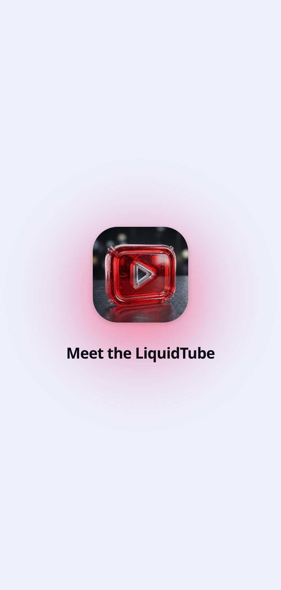
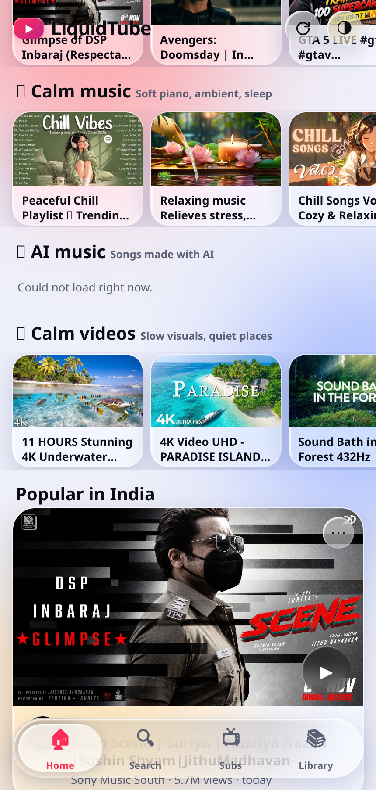
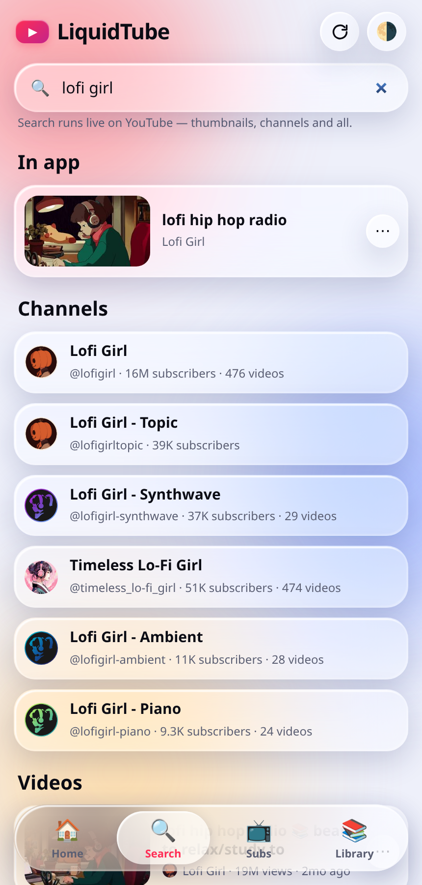
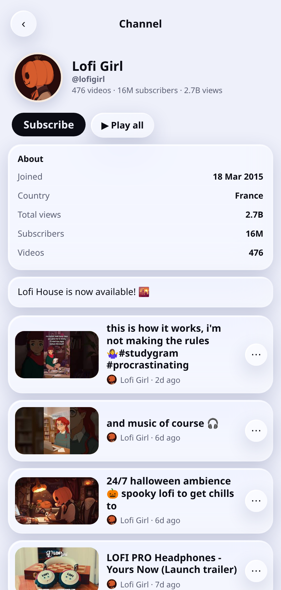
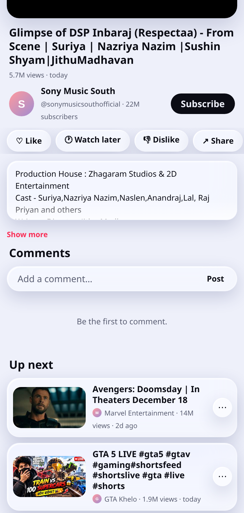
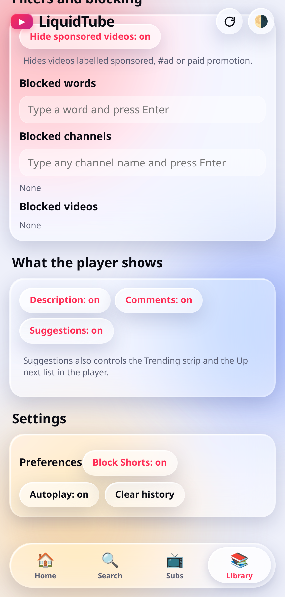
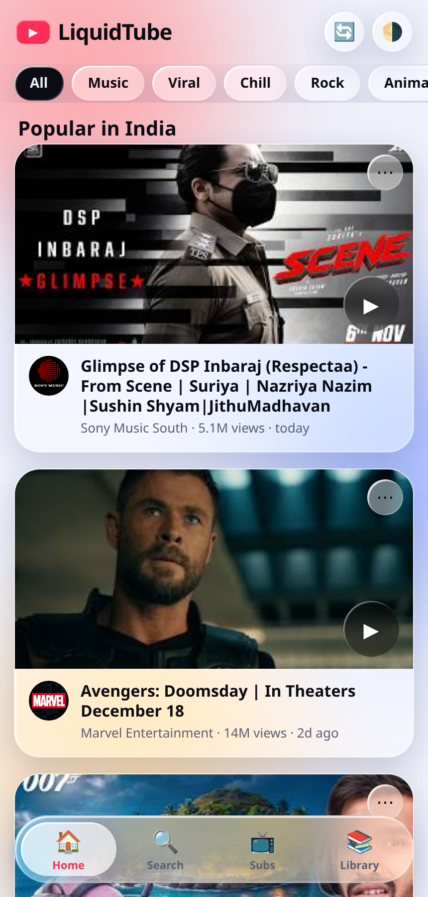
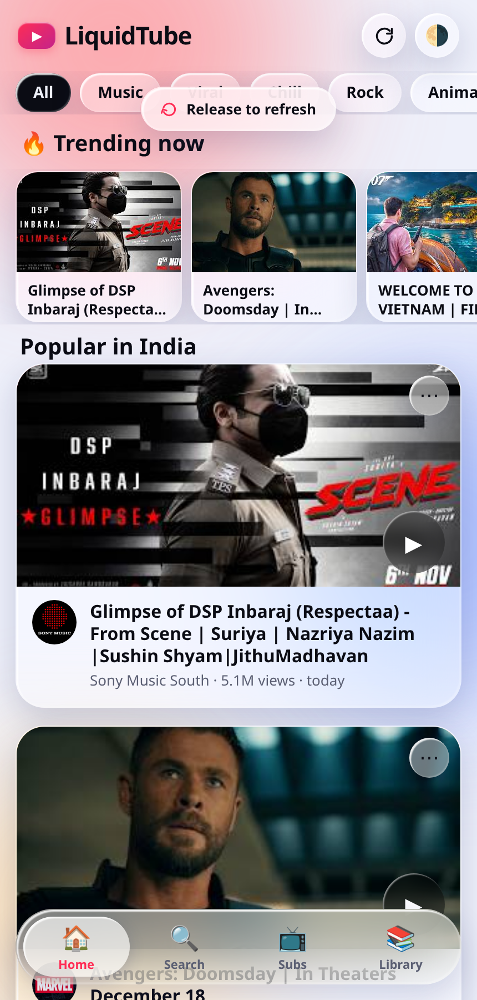

# LiquidTube

A liquid-glass YouTube client for Android — the whole UI is one self-contained HTML file, wrapped in a native WebView shell so it installs and runs like a normal app.

**[⬇ Download the APK](https://github.com/technicalnihilist-lgtm/LiquidTube/releases/latest)**


## App metadata

| Field | Value |
|---|---|
| **Name** | LiquidTube |
| **App ID / Package** | `com.liquidtube.app` |
| **Author** | technicalnihilist-lgtm |
| **Category** | Video players / Multimedia |
| **Latest version** | 1.8 (versionCode 9) |
| **Min Android** | 5.0 (API 21) |
| **APK size** | 206 KB |
| **License** | MIT |
| **Repo** | https://github.com/technicalnihilist-lgtm/LiquidTube |
| **Releases** | https://github.com/technicalnihilist-lgtm/LiquidTube/releases |

### Short description (under 80 characters)

> A liquid-glass YouTube client: live search, channels and playback in one small APK.

### Store description

LiquidTube is a YouTube client with a liquid-glass interface, wrapped in a tiny native shell — the whole UI is one self-contained HTML file, so the app installs at 206 KB and opens instantly.

It runs on live YouTube data: the home feed is the most-popular chart for your region, search returns real thumbnails and channel avatars, and every channel page shows what YouTube's own About panel shows — subscribers, total views, video count, join date and country — plus that channel's complete upload history, 50 at a time.

Watch in the built-in player with its real description, views and upload date; subscribe, like, save for later, or open the video in YouTube. Shorts get a full-screen snap feed. Three switches let you turn the description, comments and suggested videos off independently for a calmer player.

Everything you save — history, watch later, likes, playlists, subscriptions and comments — stays on your device. No account, no ads, no analytics, no background services.

## Screenshots

<p align="center"></p>

| Home — live trending | Search — channels & videos | Channel page |
|:---:|:---:|:---:|
|  |  |  |

| Player | Player controls | Suggestions switched off |
|:---:|:---:|:---:|
|  |  |  |

<p align="center"></p>

<p align="center"></p>

The launcher icon is the supplied artwork used exactly as it is — the red liquid glass tube with the chrome play mark — only scaled to each density. Nothing is redrawn, recoloured or cropped; it ships as a lossless-to-the-eye WebP for the legacy icons and as the adaptive-icon background layer, so launchers mask it to their own shape.

## What it does

Everything is live YouTube data, not a demo list — real thumbnails, real channel avatars, real counts.

- **Refresh anywhere** — the 🔄 button in the header reloads the feed, re-runs your search and refreshes an open channel page. Pull down on the home feed to do the same.
- **Home feed** — the most-popular chart for your region, with thumbnails, channel pictures, view counts and upload dates.
- **Search** — one query returns two sections: **Channels** (avatar, @handle, subscriber count and how many videos the channel has) and **Videos** (thumbnail, channel avatar, views, age). Paste a link or an 11-character ID to play anything.
- **Channel page** — tap any channel, or the channel name in the player, and you get what YouTube's own channel page shows: avatar, **@handle**, **how many videos**, **subscribers**, **total views**, the **join date**, the country, the channel description, a Subscribe button and **Play all**. Below that, every video the channel has uploaded — 50 at a time with *Load more*.
- **Player** — the video's real description (expandable), views, upload date, a channel row with avatar and handle that opens the channel, and one-tap subscribe.
- **Three switches for a calmer player** — turn **Description**, **Comments** and **Suggestions** (Up next, Trending strip) on or off independently, in Library → *What the player shows*.
- **Shorts feed** — full-screen, snap-scrolling vertical feed (can be switched off).
- **Liquid-glass UI** — frosted panels, animated colour blobs, springy bottom bar, light and dark themes.
- **Categories and topics** — your own shelves; videos are auto-added when their title or channel matches your keywords.
- **Filters and blocking** — hide sponsored videos, block words, channels or single videos.
- **Library** — history, watch later, liked videos, playlists, subscriptions and comments are saved on the device.
- **Player extras** — captions, loop, fill-screen, native fullscreen, share sheet, dislike, block.
- **Graceful offline** — the app shell is bundled, and if the feed can't load it falls back to a starter list instead of an empty screen.

## What's new in 1.8

- **Launch animation.** The app now opens on a splash: the LiquidTube icon fades up out of a soft blur, scaling from 62% with a gentle overshoot over a warm red glow, then **“Meet the LiquidTube”** rises into place. The whole thing dissolves with a small scale-up and blur into the feed.
- The intro is driven by the animation itself, not a stopwatch — the splash lifts only once the title has actually finished animating, so it never cuts off early on a slow device. If the system asks for reduced motion, the animation is skipped.
- The first feed request is deferred until the splash lifts, so the intro plays without jank while thumbnails load behind it.
- The icon used in the splash is the same supplied artwork, shipped as WebP so it costs 47 KB instead of 346 KB.

## What's new in 1.7

- The launcher icon is now the supplied artwork itself, used as-is at every density — no redrawing, no recolouring, no crop.
- Icons ship as WebP, so the APK stays at 158 KB instead of ballooning past 700 KB with PNG copies of the photo.

## What's new in 1.6

- **Channel page now reads like YouTube's About panel.** Under the avatar and @handle you get an *About* card with **Joined**, **Country** (spelled out, not the ISO code), **Total views**, **Subscribers** and **Videos**, plus the channel description and a **Channel trailer** button when the channel has one.
- **Links** are listed when the channel puts URLs in its description, and they open in your browser.
- **Fixed the channel tap.** Tapping the channel name or handle in the player used to do nothing for videos whose channel wasn't resolved yet — it now waits for the details, then opens the channel. Channels that hide their uploads no longer leave the list spinning.
- **New icon**: red liquid in a glass tube with a chrome play mark, drawn from scratch.

### What the API can't give

Two things YouTube shows on a channel page are **not** in the public Data API, so this app does not invent them: the **verified tick** (which is tied to the channel's phone/identity verification) and the **Links panel** (social handles YouTube stores separately). The About card shows every statistic the API does expose.

## What's new in 1.5

- **Bigger, sharper thumbnails.** Cards now use YouTube's `maxresdefault` (1280×720) image and fall back through `sddefault` → `hqdefault` → `mqdefault` → `default` for videos that don't have a full-size frame. List rows and the trending strip start at 320×180 instead, so scrolling stays light.
- **Full-bleed 16:9 frames.** The card thumbnail is no longer a fixed 200 px box that cropped the picture — it is a true 16:9 frame spanning the whole card, so the image shows in full with nothing cut off. The trending mini cards and list rows follow the same ratio.
- **Transparent liquid-glass icon.** A second icon build with no background plate: frosted pane, bright rim, refraction sheen and the red play mark, all on transparency.

## What's new in 1.4

- **The refresh is glass now.** The header button carries a drawn circular-arrow glyph instead of an emoji, sits in the same frosted circle as the theme toggle, and spins while it works.
- **Pull-to-refresh indicator**: drag down on the feed and a frosted pill slides out under the header, its arrow rotating with your finger, reading *Pull to refresh* → *Release to refresh*. Let go and it switches to a spinner with *Refreshing…* while the feed, your search and any open channel page reload.
- The toast that confirms the reload is the same glass pill.

## What's new in 1.3

- **New icon.** The old flat red play button is replaced by a liquid-glass mark in the app's own palette: a pink → red → purple → indigo gradient (the same colours as the background blobs), a frosted white tile floating on a soft shadow, and the play triangle filled with the app's red-to-magenta accent. It ships as a full adaptive icon (vector gradient background + glass foreground layer) plus legacy icons for older Android, so it looks right on every launcher and shape mask.
- The in-app logo badge in the header now uses the same gradient as the icon.

## What's new in 1.2

- **Refresh**: header button plus pull-to-refresh, and it refreshes whatever you are looking at.
- **Channel results in search**: searching a channel name now lists matching channels above the videos, each with its avatar, @handle, subscriber count and video count.
- **YouTube-style channel page**: banner (when the channel has one), avatar, @handle, `videos · subscribers · views`, join date, country, description, Subscribe and Play all — plus the channel's complete upload list.
- The channel name in the player is now a link to the channel page.
- Fixed a crash when a search response contained an entry with no video id.
- Fixed "· videos" showing with no number for channels that hide their video count.

## Install

1. Download `LiquidTube.apk` from the [latest release](https://github.com/technicalnihilist-lgtm/LiquidTube/releases/latest) (or grab the copy in the repo root).
2. On the phone, allow **Install unknown apps** for your browser or file manager.
3. Open the APK and tap **Install**.

Works on Android 5.0 (API 21) and newer. The APK is signed with a 2048-bit RSA key, so Play Protect may show an unknown-developer prompt — that is expected for sideloaded apps.

## Build from source

No Android Studio and no Gradle — the build uses the Android SDK command-line tools directly.

Requirements: JDK 17, Android SDK build-tools 34.0.0, platform `android-34`, `zip`, `keytool`.

```bash
export JAVA_HOME=/path/to/jdk17
export ANDROID_HOME=/path/to/android-sdk
bash build.sh          # produces LiquidTube.apk
```

`build.sh` runs the full pipeline: `aapt2 compile` → `aapt2 link` (manifest, resources and the bundled `assets/`) → `javac` → `d8` → `zipalign` → `apksigner`.

## Project structure

```
app/
  AndroidManifest.xml              manifest, permissions, launcher activity
  assets/index.html                the entire app UI (HTML + CSS + JS)
  java/com/liquidtube/app/
    MainActivity.java              WebView shell, asset server, fullscreen, back handling
  res/
    values/                        strings, colours, theme
    drawable/                      adaptive-icon background and foreground
    mipmap-*/                      launcher icons
build.sh                           dependency-free build script
LiquidTube.apk                     signed release build
screenshots/                       README images
```

## How the shell works

The page is served to the WebView from `https://liquidtube.local`, a virtual origin intercepted in `shouldInterceptRequest` and answered from `assets/` in memory. That gives the UI a proper secure origin, so `localStorage` and cross-origin fetches to the YouTube API both behave exactly as they do on the web, with no local server and no file:// quirks.

The WebView is set up for media: autoplay without a user gesture, DOM storage on, `onShowCustomView` wired to native fullscreen with immersive mode, and the back button closes the player, the channel page or a dialog before it leaves the app. Links that point outside the app open in the system browser or the YouTube app.

## Quota

YouTube meters **`search.list` separately** from the 10,000-unit allowance: a free key gets **100 searches per day**, and that is the limit you hit first. The app is built around it:

- A search is **one** call. Channels are derived from the video results; a second channel-type search only runs when the results are thin.
- The home shelves (Calm music, AI music, Calm videos) are searched **once** and then cached on the device for 12 hours.
- Everything else avoids `search` entirely: the trending feed (`chart=mostPopular`), channel data, channel uploads (`playlistItems`) and video details are all cheap non-search calls.
- When the daily limit runs out the app says so plainly instead of showing an empty screen — the feed, channels and playback keep working, only new searches pause until midnight PT.

## About the API key

The YouTube Data API v3 key is compiled into `app/assets/index.html`, so anyone who downloads the APK can read it. **Restrict it** in Google Cloud Console: APIs & Services → Credentials → your key → *API restrictions* (YouTube Data API v3 only) and *Application restrictions* (Android apps, with package name `com.liquidtube.app` and the signing certificate SHA-1 below). That keeps the quota safe even though the key is public.

Signing certificate SHA-1: `D5:3F:A0:BB:A0:41:F4:C2:B9:54:56:F0:93:1B:F0:97:A5:06:B9:C3`

To use a different key, edit the `KEY` value near the top of the script in `app/assets/index.html` and rebuild.

## Permissions

| Permission | Why |
|---|---|
| `INTERNET` | YouTube search, thumbnails, channel pictures and video playback |
| `ACCESS_NETWORK_STATE` | Lets the app fall back to the starter list when offline |
| `WAKE_LOCK` | Keeps the screen awake while a video plays |

No analytics, no ads, no background services. Everything you save stays in the app's local storage.

## License

MIT. The UI started as a single-file HTML app and is packaged here in a native WebView shell.
