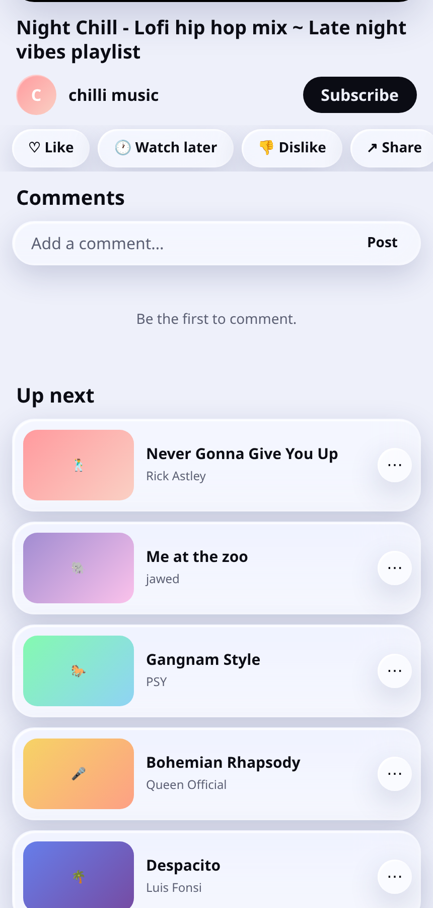
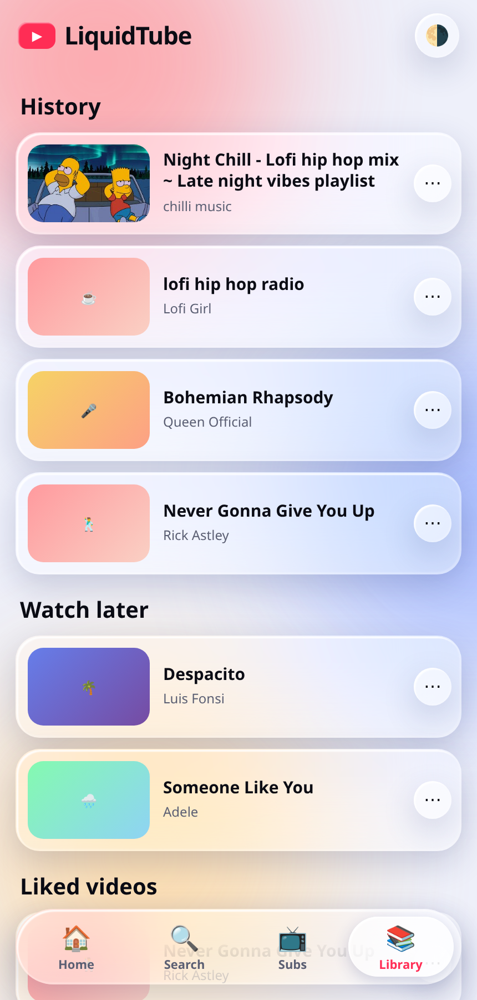
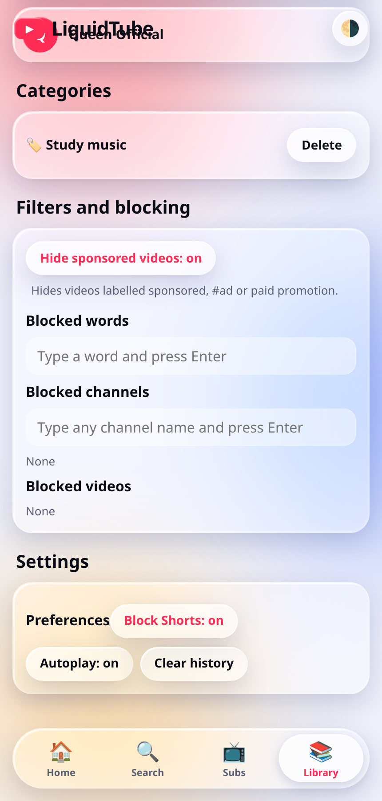
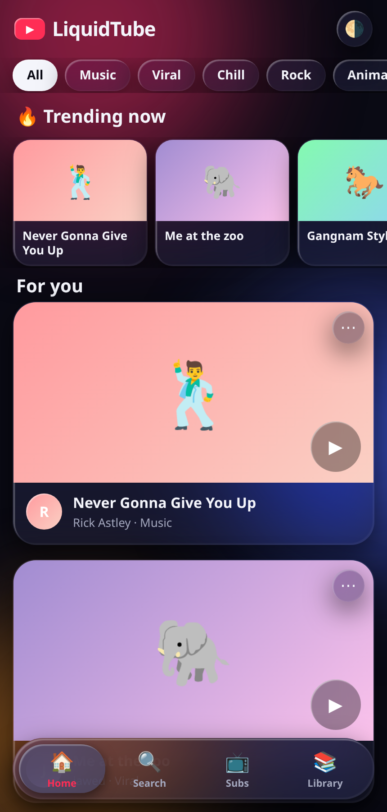

# LiquidTube

A liquid-glass YouTube client for Android — the whole UI is one self-contained HTML file, wrapped in a native WebView shell so it installs and runs like a normal app.

**[⬇ Download the APK](https://github.com/technicalnihilist-lgtm/LiquidTube/releases/latest)**


## Screenshots

| Home | Search | Player |
|:---:|:---:|:---:|
|  |  |  |

| Library | Filters & blocking | Dark mode |
|:---:|:---:|:---:|
|  |  |  |

<p align="center"></p>

## What it does

- **Live YouTube search** — results come straight from the YouTube Data API v3, with real thumbnails, titles and channel names.
- **Play anything** — paste any YouTube link or 11-character video ID and it plays inside the app.
- **Shorts feed** — full-screen, snap-scrolling vertical feed (can be switched off in Settings).
- **Liquid-glass UI** — frosted panels, animated colour blobs, springy bottom bar, light and dark themes.
- **Categories and topics** — create your own shelves; videos are auto-added when their title or channel matches your keywords.
- **Filters and blocking** — hide sponsored videos, block words, channels or single videos.
- **Library that stays put** — history, watch later, liked videos, playlists, subscriptions and comments are all saved on the device.
- **Player extras** — captions, loop, fill-screen, native fullscreen, share sheet, subscribe and dislike.
- **Offline shell** — the app itself is bundled, so it opens instantly and works without a connection; only search and playback need the network.

## Install

1. Download `LiquidTube.apk` from the [latest release](https://github.com/technicalnihilist-lgtm/LiquidTube/releases/latest) (or grab the copy in the repo root).
2. On the phone, allow **Install unknown apps** for your browser or file manager.
3. Open the APK and tap **Install**.

Works on Android 5.0 (API 21) and newer. The APK is signed with a 2048-bit RSA key, so Play Protect may show a "built for an older version" or unknown-developer prompt — that is expected for sideloaded apps.

## Build from source

No Android Studio and no Gradle — the build uses the Android SDK command-line tools directly.

Requirements: JDK 17, Android SDK build-tools 34.0.0, platform `android-34`, `zip`, `keytool`.

```bash
export JAVA_HOME=/path/to/jdk17
export ANDROID_HOME=/path/to/android-sdk
bash build.sh          # produces LiquidTube.apk
```

`build.sh` runs the full pipeline: `aapt2 compile` → `aapt2 link` (manifest, resources and the bundled `assets/`) → `javac` → `d8` → `zipalign` → `apksigner`.

## Project structure

```
app/
  AndroidManifest.xml              manifest, permissions, launcher activity
  assets/index.html                the entire app UI (HTML + CSS + JS)
  java/com/liquidtube/app/
    MainActivity.java              WebView shell, asset server, fullscreen, back handling
  res/
    values/                        strings, colours, theme
    drawable/                      adaptive-icon background and foreground
    mipmap-*/                      launcher icons
build.sh                           dependency-free build script
LiquidTube.apk                     signed release build
screenshots/                       README images
```

## How the shell works

The page is served to the WebView from `https://liquidtube.local`, a virtual origin intercepted in `shouldInterceptRequest` and answered from `assets/` in memory. That gives the UI a proper secure origin, so `localStorage` and cross-origin fetches to the YouTube API both behave exactly as they do on the web, with no local server and no file:// quirks.

The WebView is set up for media: autoplay without a user gesture, DOM storage on, `onShowCustomView` wired to native fullscreen with immersive mode, and the back button closes the player or a dialog before it leaves the app. Links that point outside the app open in the system browser or the YouTube app.

## About the API key

Search uses a YouTube Data API v3 key that is compiled into `app/assets/index.html`, so anyone who downloads the APK can read it. **Restrict it** in Google Cloud Console: APIs & Services → Credentials → your key → *API restrictions* (YouTube Data API v3 only) and *Application restrictions* (Android apps, with package name `com.liquidtube.app` and the signing certificate SHA-1 below). That keeps the quota safe even though the key is public.

Signing certificate SHA-1: `D5:3F:A0:BB:A0:41:F4:C2:B9:54:56:F0:93:1B:F0:97:A5:06:B9:C3`

To use a different key, edit the `key:` value in `S` inside `app/assets/index.html` and rebuild.

## Permissions

| Permission | Why |
|---|---|
| `INTERNET` | YouTube search, thumbnails and video playback |
| `ACCESS_NETWORK_STATE` | Lets the player know when the connection drops |
| `WAKE_LOCK` | Keeps the screen awake while a video plays |

No analytics, no ads, no background services. Everything you save stays in the app's local storage.

## License

MIT. The UI was designed as a single-file HTML app and is packaged here unchanged apart from the API key and the WebView shell.
