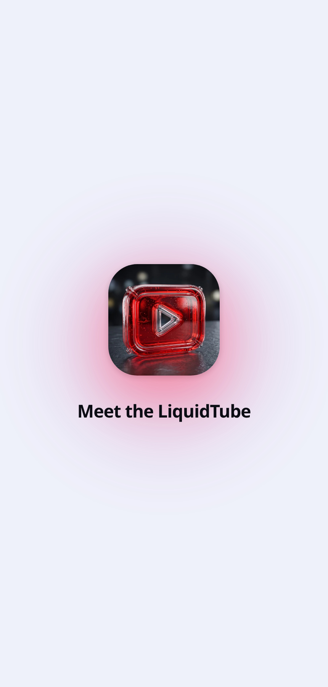
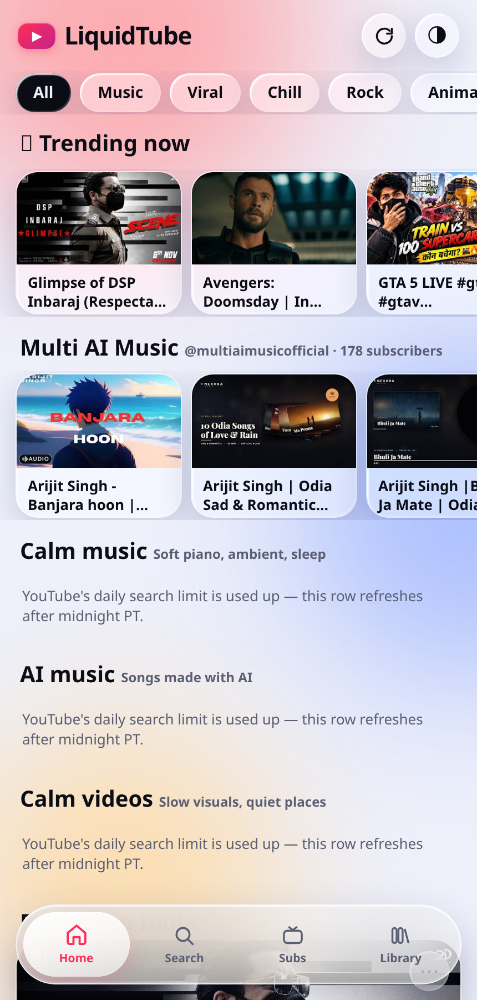
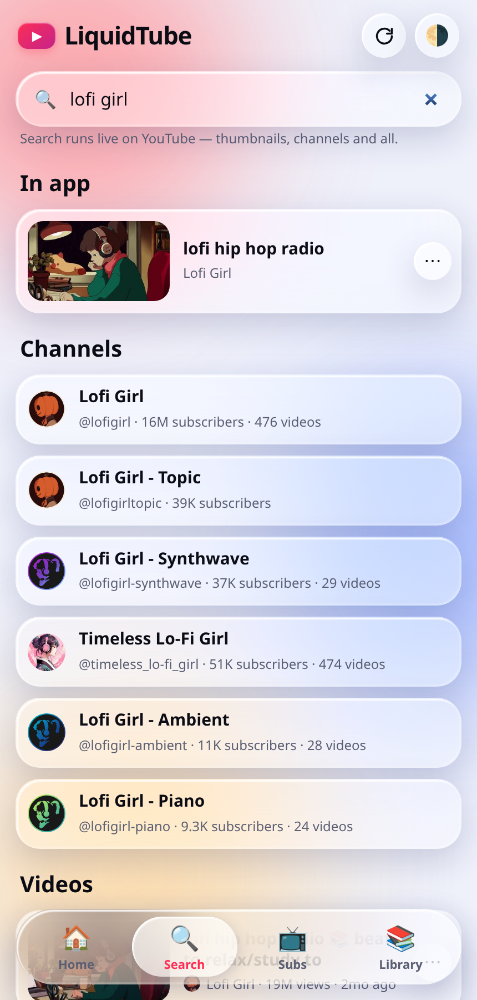
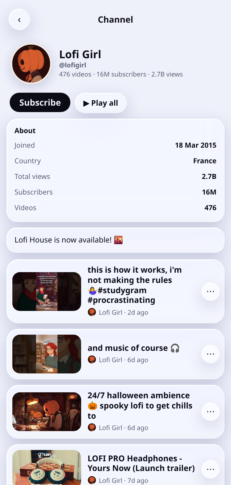
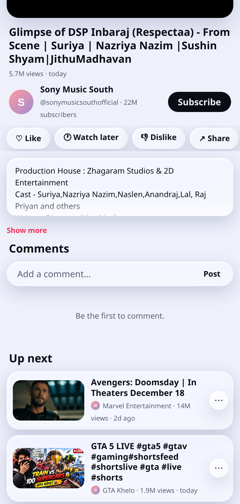
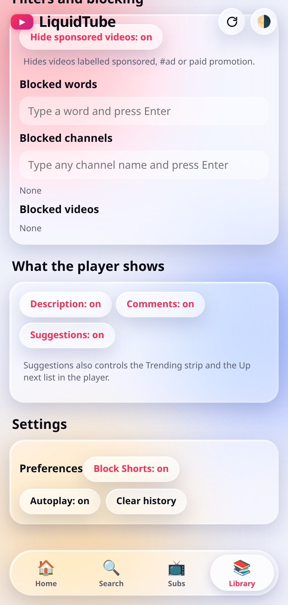
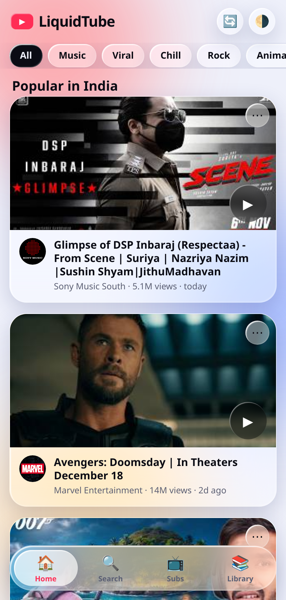
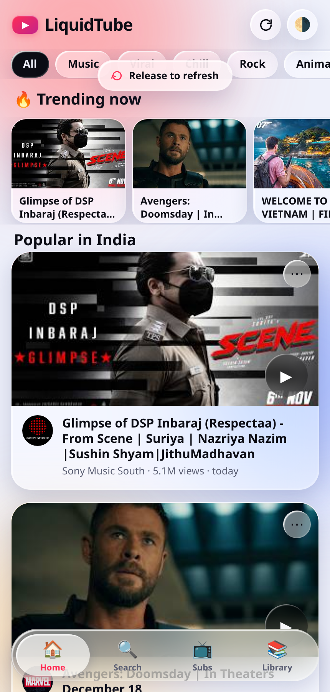

# LiquidTube

A liquid-glass YouTube client for Android — the whole UI is one self-contained HTML file, wrapped in a native WebView shell so it installs and runs like a normal app.

**[⬇ Download the APK](https://github.com/technicalnihilist-lgtm/LiquidTube/releases/latest)**

### ▶ [Watch the 42-second demo](https://github.com/technicalnihilist-lgtm/LiquidTube/releases/download/v7.0-demo/LiquidTube-demo.mp4)

A narrated walkthrough of Home, Explore, Your library, Settings (glass transparency + layouts) and Subscriptions — English voiceover, no setup needed.


## App metadata

| Field | Value |
|---|---|
| **Name** | LiquidTube |
| **App ID / Package** | `com.liquidtube.app` |
| **Author** | technicalnihilist-lgtm |
| **Category** | Video players / Multimedia |
| **Latest version** | 1.8 (versionCode 9) |
| **Min Android** | 5.0 (API 21) |
| **APK size** | 206 KB |
| **License** | MIT |
| **Repo** | https://github.com/technicalnihilist-lgtm/LiquidTube |
| **Releases** | https://github.com/technicalnihilist-lgtm/LiquidTube/releases |

### Short description (under 80 characters)

> A liquid-glass YouTube client: live search, channels and playback in one small APK.

### Store description

LiquidTube is a YouTube client with a liquid-glass interface, wrapped in a tiny native shell — the whole UI is one self-contained HTML file, so the app installs at 206 KB and opens instantly.

It runs on live YouTube data: the home feed is the most-popular chart for your region, search returns real thumbnails and channel avatars, and every channel page shows what YouTube's own About panel shows — subscribers, total views, video count, join date and country — plus that channel's complete upload history, 50 at a time.

Watch in the built-in player with its real description, views and upload date; subscribe, like, save for later, or open the video in YouTube. Shorts get a full-screen snap feed. Three switches let you turn the description, comments and suggested videos off independently for a calmer player.

Everything you save — history, watch later, likes, playlists, subscriptions and comments — stays on your device. No account, no ads, no analytics, no background services.

## Screenshots

<p align="center"></p>

| Home — live trending | Search — channels & videos | Channel page |
|:---:|:---:|:---:|
|  |  |  |

| Player | Player controls | Suggestions switched off |
|:---:|:---:|:---:|
|  |  |  |

<p align="center"></p>

<p align="center"></p>

The launcher icon is the supplied artwork used exactly as it is — the red liquid glass tube with the chrome play mark — only scaled to each density. Nothing is redrawn, recoloured or cropped; it ships as a lossless-to-the-eye WebP for the legacy icons and as the adaptive-icon background layer, so launchers mask it to their own shape.

## What it does

Everything is live YouTube data, not a demo list — real thumbnails, real channel avatars, real counts.

- **Refresh anywhere** — the 🔄 button in the header reloads the feed, re-runs your search and refreshes an open channel page. Pull down on the home feed to do the same.
- **Home feed** — the most-popular chart for your region, with thumbnails, channel pictures, view counts and upload dates.
- **Search** — one query returns two sections: **Channels** (avatar, @handle, subscriber count and how many videos the channel has) and **Videos** (thumbnail, channel avatar, views, age). Paste a link or an 11-character ID to play anything.
- **Channel page** — tap any channel, or the channel name in the player, and you get what YouTube's own channel page shows: avatar, **@handle**, **how many videos**, **subscribers**, **total views**, the **join date**, the country, the channel description, a Subscribe button and **Play all**. Below that, every video the channel has uploaded — 50 at a time with *Load more*.
- **Player** — the video's real description (expandable), views, upload date, a channel row with avatar and handle that opens the channel, and one-tap subscribe.
- **Three switches for a calmer player** — turn **Description**, **Comments** and **Suggestions** (Up next, Trending strip) on or off independently, in Library → *What the player shows*.
- **Shorts feed** — full-screen, snap-scrolling vertical feed (can be switched off).
- **Liquid-glass UI** — frosted panels, animated colour blobs, springy bottom bar, light and dark themes.
- **Categories and topics** — your own shelves; videos are auto-added when their title or channel matches your keywords.
- **Filters and blocking** — hide sponsored videos, block words, channels or single videos.
- **Library** — history, watch later, liked videos, playlists, subscriptions and comments are saved on the device.
- **Player extras** — captions, loop, fill-screen, native fullscreen, share sheet, dislike, block.
- **Graceful offline** — the app shell is bundled, and if the feed can't load it falls back to a starter list instead of an empty screen.

## What's new in 1.8

- **Launch animation.** The app now opens on a splash: the LiquidTube icon fades up out of a soft blur, scaling from 62% with a gentle overshoot over a warm red glow, then **“Meet the LiquidTube”** rises into place. The whole thing dissolves with a small scale-up and blur into the feed.
- The intro is driven by the animation itself, not a stopwatch — the splash lifts only once the title has actually finished animating, so it never cuts off early on a slow device. If the system asks for reduced motion, the animation is skipped.
- The first feed request is deferred until the splash lifts, so the intro plays without jank while thumbnails load behind it.
- The icon used in the splash is the same supplied artwork, shipped as WebP so it costs 47 KB instead of 346 KB.

## What's new in 1.7

- The launcher icon is now the supplied artwork itself, used as-is at every density — no redrawing, no recolouring, no crop.
- Icons ship as WebP, so the APK stays at 158 KB instead of ballooning past 700 KB with PNG copies of the photo.

## What's new in 1.6

- **Channel page now reads like YouTube's About panel.** Under the avatar and @handle you get an *About* card with **Joined**, **Country** (spelled out, not the ISO code), **Total views**, **Subscribers** and **Videos**, plus the channel description and a **Channel trailer** button when the channel has one.
- **Links** are listed when the channel puts URLs in its description, and they open in your browser.
- **Fixed the channel tap.** Tapping the channel name or handle in the player used to do nothing for videos whose channel wasn't resolved yet — it now waits for the details, then opens the channel. Channels that hide their uploads no longer leave the list spinning.
- **New icon**: red liquid in a glass tube with a chrome play mark, drawn from scratch.

### What the API can't give

Two things YouTube shows on a channel page are **not** in the public Data API, so this app does not invent them: the **verified tick** (which is tied to the channel's phone/identity verification) and the **Links panel** (social handles YouTube stores separately). The About card shows every statistic the API does expose.

## What's new in 1.5

- **Bigger, sharper thumbnails.** Cards now use YouTube's `maxresdefault` (1280×720) image and fall back through `sddefault` → `hqdefault` → `mqdefault` → `default` for videos that don't have a full-size frame. List rows and the trending strip start at 320×180 instead, so scrolling stays light.
- **Full-bleed 16:9 frames.** The card thumbnail is no longer a fixed 200 px box that cropped the picture — it is a true 16:9 frame spanning the whole card, so the image shows in full with nothing cut off. The trending mini cards and list rows follow the same ratio.
- **Transparent liquid-glass icon.** A second icon build with no background plate: frosted pane, bright rim, refraction sheen and the red play mark, all on transparency.

## What's new in 1.4

- **The refresh is glass now.** The header button carries a drawn circular-arrow glyph instead of an emoji, sits in the same frosted circle as the theme toggle, and spins while it works.
- **Pull-to-refresh indicator**: drag down on the feed and a frosted pill slides out under the header, its arrow rotating with your finger, reading *Pull to refresh* → *Release to refresh*. Let go and it switches to a spinner with *Refreshing…* while the feed, your search and any open channel page reload.
- The toast that confirms the reload is the same glass pill.

## What's new in 1.3

- **New icon.** The old flat red play button is replaced by a liquid-glass mark in the app's own palette: a pink → red → purple → indigo gradient (the same colours as the background blobs), a frosted white tile floating on a soft shadow, and the play triangle filled with the app's red-to-magenta accent. It ships as a full adaptive icon (vector gradient background + glass foreground layer) plus legacy icons for older Android, so it looks right on every launcher and shape mask.
- The in-app logo badge in the header now uses the same gradient as the icon.

## What's new in 1.2

- **Refresh**: header button plus pull-to-refresh, and it refreshes whatever you are looking at.
- **Channel results in search**: searching a channel name now lists matching channels above the videos, each with its avatar, @handle, subscriber count and video count.
- **YouTube-style channel page**: banner (when the channel has one), avatar, @handle, `videos · subscribers · views`, join date, country, description, Subscribe and Play all — plus the channel's complete upload list.
- The channel name in the player is now a link to the channel page.
- Fixed a crash when a search response contained an entry with no video id.
- Fixed "· videos" showing with no number for channels that hide their video count.

## Install

1. Download `LiquidTube.apk` from the [latest release](https://github.com/technicalnihilist-lgtm/LiquidTube/releases/latest) (or grab the copy in the repo root).
2. On the phone, allow **Install unknown apps** for your browser or file manager.
3. Open the APK and tap **Install**.

Works on Android 5.0 (API 21) and newer. The APK is signed with a 2048-bit RSA key, so Play Protect may show an unknown-developer prompt — that is expected for sideloaded apps.

## Build from source

No Android Studio and no Gradle — the build uses the Android SDK command-line tools directly.

Requirements: JDK 17, Android SDK build-tools 34.0.0, platform `android-34`, `zip`, `keytool`.

```bash
export JAVA_HOME=/path/to/jdk17
export ANDROID_HOME=/path/to/android-sdk
bash build.sh          # produces LiquidTube.apk
```

`build.sh` runs the full pipeline: `aapt2 compile` → `aapt2 link` (manifest, resources and the bundled `assets/`) → `javac` → `d8` → `zipalign` → `apksigner`.

## Project structure

```
app/
  AndroidManifest.xml              manifest, permissions, launcher activity
  assets/index.html                the entire app UI (HTML + CSS + JS)
  java/com/liquidtube/app/
    MainActivity.java              WebView shell, asset server, fullscreen, back handling
  res/
    values/                        strings, colours, theme
    drawable/                      adaptive-icon background and foreground
    mipmap-*/                      launcher icons
build.sh                           dependency-free build script
LiquidTube.apk                     signed release build
screenshots/                       README images
```

## How the shell works

The page is served to the WebView from `https://liquidtube.local`, a virtual origin intercepted in `shouldInterceptRequest` and answered from `assets/` in memory. That gives the UI a proper secure origin, so `localStorage` and cross-origin fetches to the YouTube API both behave exactly as they do on the web, with no local server and no file:// quirks.

The WebView is set up for media: autoplay without a user gesture, DOM storage on, `onShowCustomView` wired to native fullscreen with immersive mode, and the back button closes the player, the channel page or a dialog before it leaves the app. Links that point outside the app open in the system browser or the YouTube app.

## Quota

A search costs two `search` calls (videos + channels) — 200 units of the free 10,000 per day. Everything else is cheap: one call for the trending feed, one batched call to resolve up to 50 channel avatars, one per opened video, one per channel page and one per 50 videos loaded. A normal session stays well inside the daily allowance; if you search heavily, the channel section is the part to drop.

## About the API key

The YouTube Data API v3 key is compiled into `app/assets/index.html`, so anyone who downloads the APK can read it. **Restrict it** in Google Cloud Console: APIs & Services → Credentials → your key → *API restrictions* (YouTube Data API v3 only) and *Application restrictions* (Android apps, with package name `com.liquidtube.app` and the signing certificate SHA-1 below). That keeps the quota safe even though the key is public.

Signing certificate SHA-1: `D5:3F:A0:BB:A0:41:F4:C2:B9:54:56:F0:93:1B:F0:97:A5:06:B9:C3`

To use a different key, edit the `KEY` value near the top of the script in `app/assets/index.html` and rebuild.

## Permissions

| Permission | Why |
|---|---|
| `INTERNET` | YouTube search, thumbnails, channel pictures and video playback |
| `ACCESS_NETWORK_STATE` | Lets the app fall back to the starter list when offline |
| `WAKE_LOCK` | Keeps the screen awake while a video plays |

No analytics, no ads, no background services. Everything you save stays in the app's local storage.

## License

MIT. The UI started as a single-file HTML app and is packaged here in a native WebView shell.

---

## ⭐ Like this work? Give it a star

If you like this app and our work, please **star this repository** ⭐ and **[follow technicalnihilist-lgtm on GitHub](https://github.com/technicalnihilist-lgtm)**. If our work isn't for you, that's completely fine — the choice is yours. Thank you for stopping by!

<details>
<summary><b>🌍 Same message in 32 languages (A–Z + Indian languages)</b></summary>

- **A — Arabic** (العربية): ⭐ إذا أعجبك هذا التطبيق وعملنا، فيرجى منح المستودع نجمة ومتابعتنا. وإذا لم يعجبك عملنا، فلا مشكلة على الإطلاق — القرار قرارك. شكرًا لزيارتك!
- **B — Bengali** (বাংলা): ⭐ যদি আপনার এই অ্যাপ এবং আমাদের কাজ ভালো লাগে, তবে অনুগ্রহ করে রিপোজিটরিটিকে একটি স্টার দিন এবং আমাদের ফলো করুন। আমাদের কাজ যদি আপনার পছন্দ না হয়, তাতেও কোনো সমস্যা নেই — সিদ্ধান্ত আপনার। আমাদের পেজে আসার জন্য ধন্যবাদ!
- **C — Chinese** (中文): ⭐ 如果你喜欢这个应用和我们的作品，请给仓库点个星标并关注我们。如果我们的作品不适合你，也完全没关系——选择权在你。感谢你的到访！
- **D — Dutch** (Nederlands): ⭐ Vind je deze app en ons werk leuk? Geef de repository dan een ster en volg ons. Vind je ons werk niets, dan is dat helemaal prima — de keuze is aan jou. Bedankt voor je bezoek!
- **E — English** (English): ⭐ If you like this app and our work, please give the repository a star and follow us. If our work isn't for you, that's completely fine — the choice is yours. Thank you for stopping by!
- **F — French** (Français): ⭐ Si cette application et notre travail vous plaisent, mettez une étoile au dépôt et suivez-nous. Si notre travail n'est pas pour vous, aucun souci — c'est votre choix. Merci de votre visite !
- **G — German** (Deutsch): ⭐ Wenn dir diese App und unsere Arbeit gefallen, gib dem Repository einen Stern und folge uns. Wenn unsere Arbeit nichts für dich ist, ist das völlig in Ordnung — die Wahl liegt bei dir. Danke fürs Vorbeischauen!
- **H — Hindi** (हिन्दी): ⭐ अगर आपको यह ऐप और हमारा काम पसंद है, तो कृपया रिपॉजिटरी को स्टार दें और हमें फॉलो करें। अगर हमारा काम आपके लिए नहीं है, तो भी कोई बात नहीं — यह पूरी तरह आपकी मर्ज़ी है। यहाँ आने के लिए आपका धन्यवाद!
- **I — Indonesian** (Bahasa Indonesia): ⭐ Jika kamu suka aplikasi ini dan karya kami, beri bintang pada repositori ini dan ikuti kami. Kalau karya kami bukan untukmu, tidak masalah sama sekali — itu pilihanmu. Terima kasih sudah mampir!
- **J — Japanese** (日本語): ⭐ このアプリと私たちの仕事が気に入ったら、リポジトリにスターを付けてフォローしてください。合わない場合はまったく問題ありません — 選ぶのはあなたです。お越しいただきありがとうございます！
- **K — Korean** (한국어): ⭐ 이 앱과 저희 작업이 마음에 드신다면 저장소에 스타를 눌러 주시고 팔로우해 주세요. 저희 작업이 맞지 않으셔도 전혀 괜찮습니다 — 선택은 여러분의 몫입니다. 방문해 주셔서 감사합니다!
- **L — Lithuanian** (Lietuvių): ⭐ Jei tau patinka ši programa ir mūsų darbas, duok saugyklai žvaigždutę ir sek mus. Jei mūsų darbas ne tau, viskas gerai — pasirinkimas tavo. Ačiū, kad užsukai!
- **M — Malayalam** (മലയാളം): ⭐ നിങ്ങൾക്ക് ഈ ആപ്പും ഞങ്ങളുടെ പ്രവർത്തനവും ഇഷ്ടപ്പെട്ടെങ്കിൽ, ദയവായി റെപ്പോസിറ്ററിക്ക് ഒരു സ്റ്റാർ നൽകുകയും ഞങ്ങളെ ഫോളോ ചെയ്യുകയും ചെയ്യുക. ഞങ്ങളുടെ പ്രവർത്തനം നിങ്ങൾക്ക് അനുയോജ്യമല്ലെങ്കിൽ, അതും തികച്ചും കുഴപ്പമില്ല — തീരുമാനം നിങ്ങളുടേതാണ്. ഇവിടെ വന്നതിന് നന്ദി!
- **N — Nepali** (नेपाली): ⭐ यदि तपाईंलाई यो एप र हाम्रो काम मन पर्‍यो भने, कृपया रिपोजिटरीलाई स्टार दिनुहोस् र हामीलाई फलो गर्नुहोस्। यदि हाम्रो काम तपाईंलाई मन पर्दैन भने, पनि ठीकै छ — यो तपाईंको इच्छा हो। यहाँ आउनुभएकोमा धन्यवाद!
- **O — Odia** (ଓଡ଼ିଆ): ⭐ ଯଦି ଆପଣଙ୍କୁ ଏହି ଆପ୍ ଏବଂ ଆମର କାମ ଭଲ ଲାଗୁଛି, ତେବେ ଦୟାକରି ରିପୋଜିଟୋରୀକୁ ଗୋଟିଏ ଷ୍ଟାର୍ ଦିଅନ୍ତୁ ଏବଂ ଆମକୁ ଫଲୋ କରନ୍ତୁ। ଯଦି ଆମର କାମ ଆପଣଙ୍କ ପାଇଁ ନୁହେଁ, ତେବେ କିଛି ଅସୁବିଧା ନାହିଁ — ପସନ୍ଦ ଆପଣଙ୍କର। ଆମ ପାଖକୁ ଆସିଥିବାରୁ ଧନ୍ୟବାଦ!
- **P — Polish** (Polski): ⭐ Jeśli podoba Ci się ta aplikacja i nasza praca, daj repozytorium gwiazdkę i obserwuj nas. Jeśli nasza praca nie jest dla Ciebie, to zupełnie w porządku — wybór należy do Ciebie. Dziękujemy za odwiedziny!
- **Q — Quechua** (Runa Simi): ⭐ Kay app, ñuqaykup ruwasqanchikpas gustasunki chayqa, repositorioman huk estrella churay, ñuqaykutapas qatipayku. Mana gustasunki chayqa, allinmi — qampa akllayki. Hamusqaykimanta sulpayki!
- **R — Russian** (Русский): ⭐ Если вам нравится это приложение и наша работа, поставьте звёздочку репозиторию и подпишитесь на нас. Если наша работа не для вас — это совершенно нормально, выбор за вами. Спасибо, что заглянули!
- **S — Spanish** (Español): ⭐ Si te gusta esta app y nuestro trabajo, dale una estrella al repositorio y síguenos. Si nuestro trabajo no es para ti, no pasa nada — la decisión es tuya. ¡Gracias por pasarte!
- **T — Tamil** (தமிழ்): ⭐ உங்களுக்கு இந்த ஆப்பும் எங்க வேலையும் பிடிச்சிருந்தா, தயவுசெஞ்சு இந்த ரெபாசிட்டரிக்கு ஒரு ஸ்டார் குடுத்து, எங்களை ஃபாலோ பண்ணுங்க. எங்க வேலை உங்களுக்கு செட் ஆகலைன்னாலும் பரவாயில்லை — அது உங்க விருப்பம். இங்கே வந்ததுக்கு நன்றி!
- **U — Urdu** (اردو): ⭐ اگر آپ کو یہ ایپ اور ہمارا کام پسند آئے تو براہ کرم ریپازٹری کو سٹار دیں اور ہمیں فالو کریں۔ اگر ہمارا کام آپ کے لیے نہیں ہے، تو یہ بالکل ٹھیک ہے — انتخاب آپ کا ہے۔ یہاں تشریف لانے کا شکریہ!
- **V — Vietnamese** (Tiếng Việt): ⭐ Nếu bạn thích ứng dụng này và công việc của chúng tôi, hãy tặng kho lưu trữ một ngôi sao và theo dõi chúng tôi. Nếu công việc của chúng tôi không phù hợp với bạn, điều đó hoàn toàn ổn — lựa chọn là của bạn. Cảm ơn bạn đã ghé qua!
- **W — Welsh** (Cymraeg): ⭐ Os ydych chi'n hoffi'r ap hwn a'n gwaith, rhowch seren i'r storfa a dilynwch ni. Os nad yw ein gwaith ar eich cyfer, mae hynny'n hollol iawn — chi sydd i benderfynu. Diolch am alw heibio!
- **X — Xhosa** (isiXhosa): ⭐ Ukuba uyayithanda le app nomsebenzi wethu, nika irepo inkwenkwezi kwaye usilandele. Ukuba umsebenzi wethu awukufanelanga, akukho ngxaki — lukhetho lwakho. Enkosi ngokutyelela!
- **Y — Yoruba** (Yorùbá): ⭐ Bí app yìí àti iṣẹ́ wa bá wù ọ́, jọ̀wọ́ fún àkójọpọ̀ náà ní ìràwọ̀ kí o sì tẹ̀lé wa. Bí iṣẹ́ wa kò bá yẹ ọ́, kò séwu — ìwọ ni ó yàn. Ẹ ṣé fún wíwá!
- **Z — Zulu** (isiZulu): ⭐ Uma uthanda le app nomsebenzi wethu, nikeza isitoreji inkanyezi bese usilandela. Uma umsebenzi wethu ungakufanele, akunankinga — wukukhetha kwakho. Siyabonga ngokuvakasha!

**More Indian languages**

- **Assamese** (অসমীয়া): ⭐ যদি আপুনি এই এপটো আৰু আমাৰ কাম ভাল পায়, তেন্তে অনুগ্ৰহ কৰি ৰিপজিটৰীটোক এটা ষ্টাৰ দিয়ক আৰু আমাক ফ'ল' কৰক। যদি আমাৰ কাম আপোনাৰ বাবে নহয়, তেন্তে সেয়া একেবাৰে ঠিক আছে — সিদ্ধান্তটো আপোনাৰ। আমাৰ ইয়ালৈ অহাৰ বাবে ধন্যবাদ!
- **Gujarati** (ગુજરાતી): ⭐ જો તમને આ એપ અને અમારું કામ ગમતું હોય, તો પ્લીઝ રિપોઝિટરીને સ્ટાર આપો અને અમને ફોલો કરો. જો અમારું કામ તમને ન ગમતું હોય, તો તે પણ બરાબર છે — પસંદગી તમારી છે. અહીં આવવા બદલ આભાર!
- **Kannada** (ಕನ್ನಡ): ⭐ ನಿಮಗೆ ಈ ಆ್ಯಪ್ ಮತ್ತು ನಮ್ಮ ಕೆಲಸ ಇಷ್ಟವಾದರೆ, ದಯವಿಟ್ಟು ರೆಪೊಸಿಟರಿಗೆ ಸ್ಟಾರ್ ಕೊಡಿ ಮತ್ತು ನಮ್ಮನ್ನು ಫಾಲೋ ಮಾಡಿ. ನಮ್ಮ ಕೆಲಸ ನಿಮಗೆ ಸರಿಹೊಂದದಿದ್ದರೆ, ಅದೂ ಪರವಾಗಿಲ್ಲ — ಆಯ್ಕೆ ನಿಮ್ಮದು. ಭೇಟಿ ನೀಡಿದ್ದಕ್ಕೆ ಧನ್ಯವಾದಗಳು!
- **Marathi** (मराठी): ⭐ जर तुम्हाला हे ॲप आणि आमचं काम आवडलं असेल, तर कृपया रिपॉझिटरीला स्टार द्या आणि आम्हाला फॉलो करा. जर आमचं काम तुम्हाला आवडत नसेल, तर काही हरकत नाही — ती तुमची निवड आहे. इथे आल्याबद्दल धन्यवाद!
- **Punjabi** (ਪੰਜਾਬੀ): ⭐ ਜੇ ਤੁਹਾਨੂੰ ਇਹ ਐਪ ਅਤੇ ਸਾਡਾ ਕੰਮ ਪਸੰਦ ਹੈ, ਤਾਂ ਕਿਰਪਾ ਕਰਕੇ ਰਿਪੋਜ਼ਟਰੀ ਨੂੰ ਸਟਾਰ ਦਿਓ ਅਤੇ ਸਾਨੂੰ ਫਾਲੋ ਕਰੋ। ਜੇ ਸਾਡਾ ਕੰਮ ਤੁਹਾਡੇ ਲਈ ਨਹੀਂ ਹੈ, ਤਾਂ ਕੋਈ ਗੱਲ ਨਹੀਂ — ਚੋਣ ਤੁਹਾਡੀ ਹੈ। ਸਾਡੇ ਪੇਜ 'ਤੇ ਆਉਣ ਲਈ ਧੰਨਵਾਦ!
- **Telugu** (తెలుగు): ⭐ మీకు ఈ యాప్, మా పని నచ్చితే, దయచేసి రిపోజిటరీకి ఒక స్టార్ ఇచ్చి మమ్మల్ని ఫాలో అవ్వండి. ఒకవేళ మా పని మీకు నచ్చకపోతే, పర్వాలేదు — అది మీ ఇష్టం. మమ్మల్ని సందర్శించినందుకు ధన్యవాదాలు!

</details>
