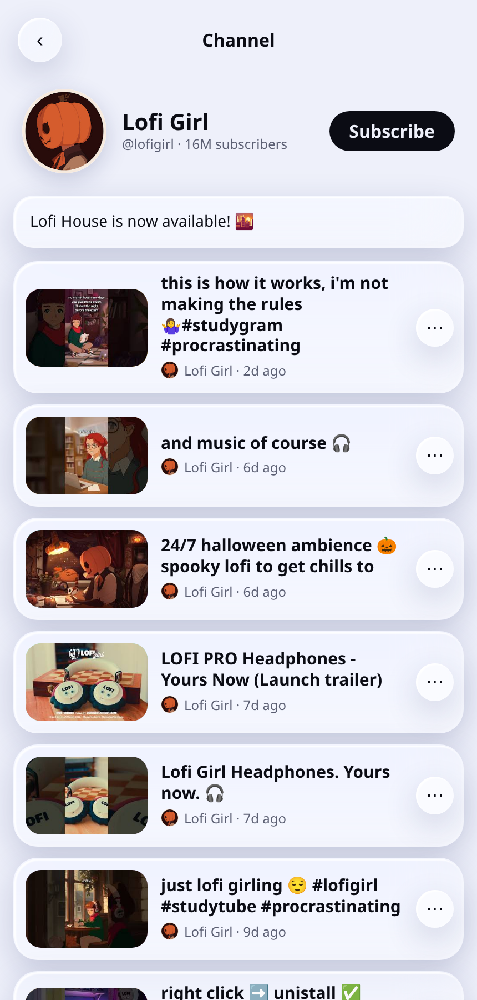
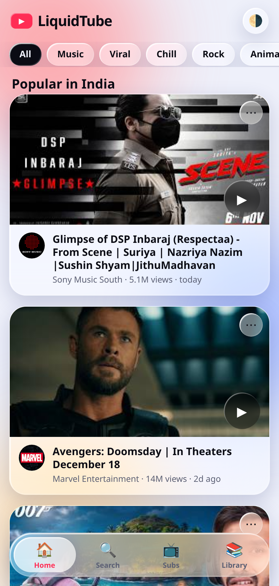

# LiquidTube

A liquid-glass YouTube client for Android — the whole UI is one self-contained HTML file, wrapped in a native WebView shell so it installs and runs like a normal app.

**[⬇ Download the APK](https://github.com/technicalnihilist-lgtm/LiquidTube/releases/latest)**


## Screenshots

| Home — live trending | Search — real thumbnails | Player — description & up next |
|:---:|:---:|:---:|
|  |  |  |

| Channel page | Player controls | Suggestions switched off |
|:---:|:---:|:---:|
|  |  |  |

<p align="center"></p>

## What it does

Everything is live YouTube data, not a demo list — real thumbnails, real channel avatars, real view counts.

- **Home feed** — the most-popular chart for your region, with thumbnails, channel pictures, view counts and upload dates.
- **Search** — YouTube Data API v3 results with thumbnails, the channel's avatar, subscriber-backed handles, view counts and age. Paste a link or an 11-character ID to play anything.
- **Channel pages** — tap any channel to see its avatar, **@handle**, subscriber count and description, then browse **every video it has uploaded**, 50 at a time with *Load more*.
- **Player** — the video's real description (expandable), views, upload date, channel row with avatar and handle, and one-tap subscribe.
- **Three switches for a calmer player** — turn **Description**, **Comments** and **Suggestions** (Up next, Trending strip) on or off independently, in Library → *What the player shows*.
- **Shorts feed** — full-screen, snap-scrolling vertical feed (can be switched off).
- **Liquid-glass UI** — frosted panels, animated colour blobs, springy bottom bar, light and dark themes.
- **Categories and topics** — your own shelves; videos are auto-added when their title or channel matches your keywords.
- **Filters and blocking** — hide sponsored videos, block words, channels or single videos.
- **Library** — history, watch later, liked videos, playlists, subscriptions and comments are saved on the device.
- **Player extras** — captions, loop, fill-screen, native fullscreen, share sheet, dislike, block.
- **Graceful offline** — the app shell is bundled, and if the feed can't load it falls back to a starter list instead of an empty screen.

## What's new in 1.1

- Home and search now pull live YouTube data — real thumbnails and channel avatars everywhere, with view counts and upload dates.
- New channel page: avatar, @handle, subscriber count, description, and the channel's complete upload history.
- The player shows the real video description, the channel's handle and subscriber count, and a working subscribe button.
- New toggles for **Description**, **Comments** and **Suggestions**.
- Long titles no longer spill out of the trending cards; HTML-escaped titles from the API are decoded properly.
- Channel avatars fall back to a coloured initial tile if an image can't load.

## Install

1. Download `LiquidTube.apk` from the [latest release](https://github.com/technicalnihilist-lgtm/LiquidTube/releases/latest) (or grab the copy in the repo root).
2. On the phone, allow **Install unknown apps** for your browser or file manager.
3. Open the APK and tap **Install**.

Works on Android 5.0 (API 21) and newer. The APK is signed with a 2048-bit RSA key, so Play Protect may show an unknown-developer prompt — that is expected for sideloaded apps.

## Build from source

No Android Studio and no Gradle — the build uses the Android SDK command-line tools directly.

Requirements: JDK 17, Android SDK build-tools 34.0.0, platform `android-34`, `zip`, `keytool`.

```bash
export JAVA_HOME=/path/to/jdk17
export ANDROID_HOME=/path/to/android-sdk
bash build.sh          # produces LiquidTube.apk
```

`build.sh` runs the full pipeline: `aapt2 compile` → `aapt2 link` (manifest, resources and the bundled `assets/`) → `javac` → `d8` → `zipalign` → `apksigner`.

## Project structure

```
app/
  AndroidManifest.xml              manifest, permissions, launcher activity
  assets/index.html                the entire app UI (HTML + CSS + JS)
  java/com/liquidtube/app/
    MainActivity.java              WebView shell, asset server, fullscreen, back handling
  res/
    values/                        strings, colours, theme
    drawable/                      adaptive-icon background and foreground
    mipmap-*/                      launcher icons
build.sh                           dependency-free build script
LiquidTube.apk                     signed release build
screenshots/                       README images
```

## How the shell works

The page is served to the WebView from `https://liquidtube.local`, a virtual origin intercepted in `shouldInterceptRequest` and answered from `assets/` in memory. That gives the UI a proper secure origin, so `localStorage` and cross-origin fetches to the YouTube API both behave exactly as they do on the web, with no local server and no file:// quirks.

The WebView is set up for media: autoplay without a user gesture, DOM storage on, `onShowCustomView` wired to native fullscreen with immersive mode, and the back button closes the player, the channel page or a dialog before it leaves the app. Links that point outside the app open in the system browser or the YouTube app.

## Quota

The API calls are deliberately cheap: one call for the trending feed, one batched call to resolve up to 50 channel avatars, one call per search (plus one for view counts), one per opened video, one per channel page and one per 50 videos loaded. A normal session stays well inside the free 10,000 units per day.

## About the API key

The YouTube Data API v3 key is compiled into `app/assets/index.html`, so anyone who downloads the APK can read it. **Restrict it** in Google Cloud Console: APIs & Services → Credentials → your key → *API restrictions* (YouTube Data API v3 only) and *Application restrictions* (Android apps, with package name `com.liquidtube.app` and the signing certificate SHA-1 below). That keeps the quota safe even though the key is public.

Signing certificate SHA-1: `D5:3F:A0:BB:A0:41:F4:C2:B9:54:56:F0:93:1B:F0:97:A5:06:B9:C3`

To use a different key, edit the `KEY` value near the top of the script in `app/assets/index.html` and rebuild.

## Permissions

| Permission | Why |
|---|---|
| `INTERNET` | YouTube search, thumbnails, channel pictures and video playback |
| `ACCESS_NETWORK_STATE` | Lets the app fall back to the starter list when offline |
| `WAKE_LOCK` | Keeps the screen awake while a video plays |

No analytics, no ads, no background services. Everything you save stays in the app's local storage.

## License

MIT. The UI started as a single-file HTML app and is packaged here in a native WebView shell.
